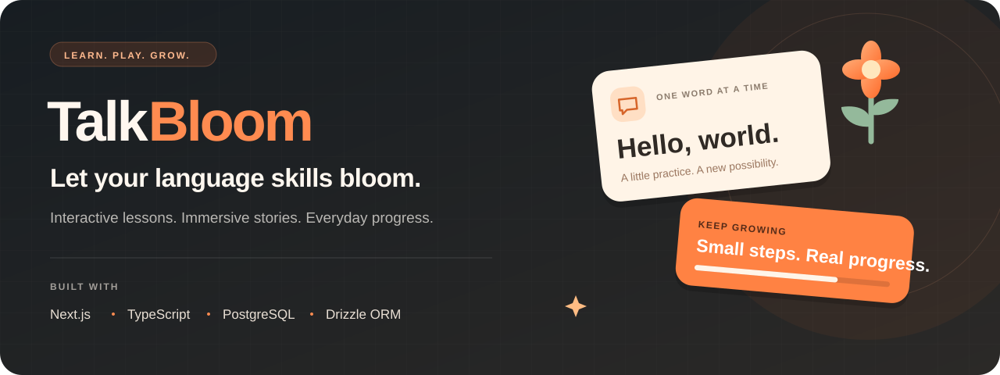

<p align="center">
  
</p>

<p align="center">
  <strong>A playful place to build your next language habit.</strong><br />
  Learn through bite-sized challenges, explore illustrated stories, and watch your progress grow.
</p>

<p align="center">
  <a href="https://talkbloom.vercel.app"><strong>Explore TalkBloom ↗</strong></a>
  &nbsp; · &nbsp;
  <a href="#features">Features</a>
  &nbsp; · &nbsp;
  <a href="#getting-started">Getting started</a>
  &nbsp; · &nbsp;
  <a href="https://github.com/aeubs66/talkbloomApp/issues">Feedback</a>
</p>

<p align="center">
  
  
  
  
  
</p>

---

## Meet TalkBloom

TalkBloom is a full-stack language-learning web application that combines structured courses with game-like practice and multimedia storytelling. Learners move through units and lessons, answer visual and audio-supported challenges, and earn points along the way.

The project also includes story playback with translated text, illustrations, and audio, plus an administration interface for managing learning content.

## Features

| Learn a little | Come back for more |
| :--- | :--- |
| **Structured courses** — Follow courses, units, and lessons through a visual learning path. | **Saved progress** — Track completed challenges, points, and your active course. |
| **Interactive practice** — Answer selection and assisted challenges with image and audio support. | **Hearts & rewards** — Practice with a hearts system and refill options in the shop. |
| **Immersive stories** — Explore illustrated chapters with audio, transitions, and reading progress. | **Quests & leaderboard** — Work toward point goals and compare progress with other learners. |
| **Translation support** — Learning content and story text include translation fields. | **Accounts & subscriptions** — Clerk authentication and Stripe subscription integration. |

### Behind the experience

- **Content administration:** Manage courses, units, lessons, challenges, and stories with React Admin.
- **Persistent learning data:** PostgreSQL tables and Drizzle relations connect content, user progress, and subscriptions.
- **Responsive interface:** Tailwind CSS, Radix UI components, and Framer Motion power the presentation.

## Tech stack

| Layer | Technologies |
| :--- | :--- |
| Application | Next.js 14 App Router · React 18 · TypeScript |
| Interface | Tailwind CSS · Radix UI · Lucide · Framer Motion |
| Data | PostgreSQL · Neon · Drizzle ORM |
| Authentication | Clerk |
| Payments | Stripe Checkout · Customer Portal · Webhooks |
| State & administration | Zustand · React Admin |

## Getting started

You will need a Node.js version compatible with Next.js 14, npm, a PostgreSQL database, and your own Clerk and Stripe test credentials.

### 1. Clone and install

```bash
git clone https://github.com/aeubs66/talkbloomApp.git
cd talkbloomApp
npm ci
```

### 2. Configure your environment

Copy [`.env.example`](.env.example) to `.env` and replace the placeholders with your own credentials.

**PowerShell**

```powershell
Copy-Item .env.example .env
```

**macOS / Linux**

```bash
cp .env.example .env
```

| Variable | Purpose |
| :--- | :--- |
| `NEXT_PUBLIC_CLERK_PUBLISHABLE_KEY` | Clerk browser authentication |
| `CLERK_SECRET_KEY` | Clerk server authentication |
| `DATABASE_URL` | PostgreSQL connection string |
| `STRIPE_API_SECRET_KEY` | Stripe API authentication; use a test key locally |
| `STRIPE_WEBHOOK_SECRET` | Verification of Stripe webhook events |
| `NEXT_PUBLIC_APP_URL` | Application URL; `http://localhost:3000` for local development |

Keep real credentials out of commits, screenshots, and issue reports.

### 3. Create the database schema and start

Use a separate development database, then run:

```bash
npm run db:push
npm run dev
```

Open [localhost:3000](http://localhost:3000). Schema creation does not populate courses: add learning content through the admin interface after configuring your own Clerk user ID in [`lib/admin.ts`](lib/admin.ts). The current admin check uses that file's allowlist; `CLERK_ADMIN_IDS` in the environment example is not read by it.

For subscription testing, forward Stripe test events to `/api/webhooks/stripe` and put the corresponding signing secret in `STRIPE_WEBHOOK_SECRET`.

<details>
<summary><strong>Available commands</strong></summary>

| Command | Purpose |
| :--- | :--- |
| `npm run dev` | Start the development server |
| `npm run build` | Create a production build |
| `npm start` | Serve the production build |
| `npm run lint` | Run the configured lint checks |
| `npm run format` | Check formatting |
| `npm run db:studio` | Open the database browser |
| `npm run db:push` | Apply the schema to the configured database |

The existing `db:prod` and `db:reset` scripts delete data. Inspect them before use; the bundled seed also references legacy assets and is not part of the setup above.

</details>

## Explore the source

| Location | What lives here |
| :--- | :--- |
| [`app/(main)/`](app/%28main%29) | Courses, learning path, leaderboard, quests, and shop |
| [`app/lesson/`](app/lesson) | Interactive lesson and quiz experience |
| [`app/story/`](app/story) | Story library, playback, and reading progress |
| [`app/admin/`](app/admin) | Learning-content administration |
| [`app/api/`](app/api) | Content endpoints and Stripe webhooks |
| [`actions/`](actions) | Server actions for progress and subscriptions |
| [`db/`](db) | Schema, database connections, and queries |
| [`components/`](components) | Shared interface components |
| [`public/`](public) | Illustrations, audio, and other static assets |

## Contributing

Have an idea or found something that could work better? [Open an issue](https://github.com/aeubs66/talkbloomApp/issues) with the details, or read the [contribution guide](CONTRIBUTING.md) before submitting a pull request.

## Acknowledgements

TalkBloom builds on the [Duolingo Clone / Lingo project by Sanidhya Kumar Verma](https://github.com/sanidhyy/duolingo-clone). The application retains parts of that foundation alongside TalkBloom's branding, translated content, and story experience.

---

<p align="center">
  <strong>One word. One lesson. A little more confidence.</strong><br />
  <a href="https://talkbloom.vercel.app">Start exploring TalkBloom ↗</a>
</p>
